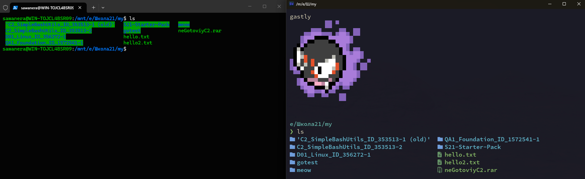

  

# 🖥️ Турбо-гайд по настройке терминала для Школы 21

**WSL · WezTerm · Fish · полезные инструменты**

Пошаговая настройка рабочего окружения в Windows для учёбы.

---

## 🚀 Быстрый старт

1. Скачай или склонируй репозиторий.
2. Открой `README.md` на GitHub или в своём редакторе.
3. Выполняй инструкции по порядку, начиная с настройки SSH-ключей.

## 📚 Содержание

| Шаг | Инструкция | Что делаем |
| --- | --- | --- |
| 01 | [SSH-ключи](01-ssh-key.md) | Настраиваем доступ к GitLab из Windows и WSL. |
| 02 | [Установка WSL](02-wsl.md) | Устанавливаем Linux внутри Windows. |
| 03 | [WezTerm](03-wezterm.md) | Устанавливаем и настраиваем терминал. |
| 04 | [Fish](04-fish.md) | Устанавливаем оболочку и необходимые инструменты. |

## 🎥 Видеоинструкция

Предпочитаешь видео? Посмотри настройку в отдельной инструкции:

**[▶ Смотреть видео на YouTube](https://youtu.be/6aNrYnO1NI0)**

---

## 🎯 Для кого этот гайд?

Для студентов Школы 21, которые прошли бассейн и перешли на основной этап обучения.

Гайд поможет настроить рабочее окружение на Windows, чтобы меньше времени тратить на конфигурацию терминала и больше — на решение задач.

## 🛠 Что будем настраивать

- **WSL** — Linux-окружение внутри Windows.
- **SSH-ключи** — отдельная настройка доступа к GitLab для Windows и WSL.
- **Шрифты** — шрифты для корректного отображения символов в терминале.
- **WezTerm** — настраиваемый терминал с готовой конфигурацией.
- **Fish** — альтернативная командная оболочка.
- **Starship** — информативная строка приглашения командной оболочки (prompt).
- **Zoxide и Fzf** — инструменты для навигации по каталогам и поиска.
- **Eza, Bat и Ripgrep** — инструменты для просмотра файлов, чтения текста и поиска по содержимому.
- **Fisher** — менеджер плагинов для Fish.
- **Pokemon-colorscripts** — декоративные изображения покемонов в терминале.
- **Готовый конфиг Fish** — настройки, чтобы не собирать окружение вручную.

## ✨ Что получится в итоге

После выполнения инструкций у тебя будет:

- Linux-окружение через WSL;
- настроенный терминал WezTerm;
- Fish вместо стандартной оболочки Bash;
- информативный prompt через Starship;
- удобные команды для навигации и работы с файлами;
- готовое окружение для учёбы в Школе 21.

---

## 🏁 Начать настройку

Первый шаг — настройка SSH-ключей для GitLab.

**[01 — Настройка SSH-ключей →](01-ssh-key.md)**
